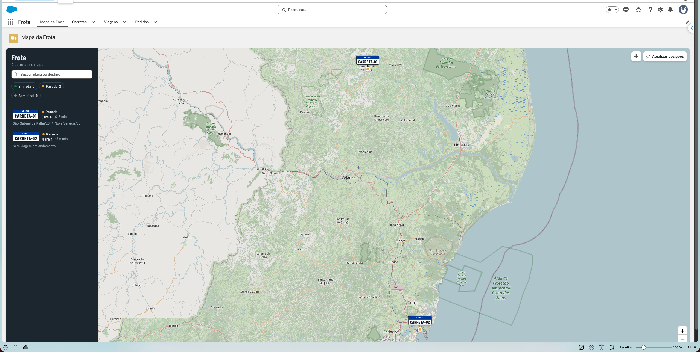
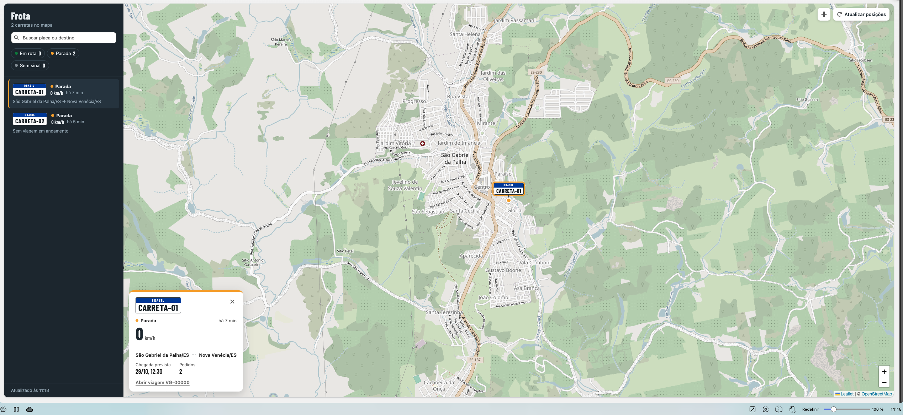

# Frota Salesforce

Rastreamento de frota no Salesforce: a posição das carretas vem do [Traccar](https://www.traccar.org) e aparece num mapa (LWC + Leaflet/OpenStreetMap). Pedidos (Order) são vinculados a uma Viagem, e a viagem a uma Carreta.



*Guia **Mapa da Frota**: painel com busca e filtros por situação; cada carreta aparece no mapa como uma placa Mercosul.*



*Ao selecionar uma carreta, o mapa se aproxima e o cartão mostra a situação, a velocidade e a viagem em andamento (origem → destino, chegada prevista e quantidade de pedidos).*

## Como funciona

```
Celular (Traccar Client) ou rastreador → Servidor Traccar
   ← Salesforce busca a cada N min (FrotaSyncScheduler → FrotaSyncJob → TraccarClient, via Named Credential)
   → Carreta__c: última posição, velocidade e data do GPS (sem histórico)
   → LWC frotaMapa relê a cada 30 s (guia "Mapa da Frota" no app Frota)
```

| Camada | Classe |
|---|---|
| HTTP do Traccar (`/api/devices`, `/api/positions`) | `TraccarClient` |
| Regra: casar dispositivo ↔ carreta, converter nós → km/h, ignorar posição antiga | `FrotaSyncService` |
| Job assíncrono (callouts antes do DML) | `FrotaSyncJob` |
| Agendamento (um job por minuto do intervalo) | `FrotaSyncScheduler` |
| Dados do mapa e botão "Atualizar agora" | `FrotaMapaController` |

Status no mapa, calculado pela última posição recebida:

| Última posição | Situação | Vira **Sem sinal** depois de |
|---|---|---|
| ≥ 5 km/h | **Em rota** | 15 min sem posição nova |
| < 5 km/h | **Parada** | 2 h sem posição nova |

A tolerância é maior para carreta parada porque celular em segundo plano e sem movimento para de enviar posição para poupar bateria (medido: até 44 min de silêncio). Carreta que estava andando e some é o caso que precisa de atenção. Os limites ficam em `FrotaMapaController` (`MINUTOS_SEM_SINAL_EM_ROTA` e `MINUTOS_SEM_SINAL_PARADA`).

## Como os objetos se relacionam

```
 Traccar (fora do Salesforce)          Salesforce
 ┌──────────────────────┐   identificador   ┌──────────────┐  1 ─── N  ┌──────────────┐  1 ─── N  ┌──────────────┐
 │ Dispositivo          │ ────────────────▶ │ Carreta__c   │ ────────▶ │ Viagem__c    │ ────────▶ │ Order        │
 │ (celular/rastreador) │   (uniqueId)      │ (o veículo)  │  Carreta  │ (o trajeto)  │  Viagem   │ (o pedido)   │
 └──────────────────────┘                   └──────────────┘           └──────────────┘           └──────────────┘
```

O Traccar só sabe **onde o aparelho está**. É o Salesforce que diz **qual veículo é**, **qual trajeto ele faz** e **o que ele leva**. Cada elo é um registro que alguém cria:

| Objeto | O que representa | Ligação | Quem cria |
|---|---|---|---|
| **Dispositivo** (Traccar) | O celular ou rastreador que envia GPS | — | Cadastrado no Traccar |
| **Carreta** (`Carreta__c`) | O veículo. `Name` é a placa | Campo **Identificador Traccar** = *Identificador* do dispositivo no Traccar (texto, único, sem diferenciar maiúsculas) | Manual, guia Carretas |
| **Viagem** (`Viagem__c`) | Um trajeto da carreta: origem, destino, chegada prevista, status | Lookup **Carreta** | Manual, guia Viagens |
| **Pedido** (`Order`) | O que está sendo transportado | Lookup **Viagem** (`Order.Viagem__c`) | Manual, no Pedido |

A carreta não aponta para o pedido diretamente. O pedido fica na viagem, porque uma carreta leva vários pedidos por viagem e faz várias viagens ao longo do tempo, e a viagem guarda esse histórico.

### Ordem para colocar uma carreta no mapa

1. **Dispositivo no Traccar** com um *Identificador* (no app Traccar Client, o mesmo valor em "Identificador do dispositivo").
2. **Carreta** no Salesforce com **Identificador Traccar** igual ao do passo 1. **Sem essa carreta, o dispositivo é ignorado**, mesmo enviando posição.
3. Aguardar a sincronização (ou clicar em **Atualizar posições**). Ela preenche **Última Posição**, **Última Atualização** e **Velocidade**; esses campos não são editados à mão.
4. Opcional: **Viagem** com a carreta e status **Em andamento**, para o cartão mostrar origem → destino, chegada prevista e pedidos.
5. Opcional: **Pedidos** com o campo **Viagem** preenchido. O cartão conta os pedidos, e na página do Pedido o mapa mostra só a carreta dele.

### Regras que decidem o que aparece

| Situação | Resultado no mapa |
|---|---|
| Dispositivo do Traccar sem Carreta com o mesmo identificador | Não aparece (ignorado pela sincronização) |
| Carreta sem nenhuma posição recebida ainda | Não aparece |
| Carreta com **Ativa** desmarcado | Não aparece, nem na própria página |
| Carreta com mais de uma viagem | O cartão mostra só a mais recente **Em andamento**; Planejada, Concluída e Cancelada ficam como histórico |
| Pedido de viagem que não está Em andamento | Não entra na contagem de pedidos do cartão |
| Página de **Pedido** | Mostra a carreta da viagem do pedido; pedido sem viagem (ou viagem sem carreta) mostra o aviso de vazio |
| Página de **Viagem** ou **Carreta** | Mostra só aquela carreta |
| Posição mais antiga que a já gravada | Ignorada (reprocessar não volta a carreta no tempo) |

### Exclusões

- **Carreta** com viagens **não pode ser excluída** (lookup com *Restrict*). Para tirar do mapa sem perder histórico, desmarque **Ativa**.
- **Viagem** excluída: os pedidos continuam existindo e só perdem o vínculo (lookup com *Set Null*).

## Configuração (uma vez por org)

1. **Traccar**: crie uma conta em https://demo.traccar.org (só para testes, porque o servidor é público) e adicione um dispositivo com um *Identificador*, ex.: `celular-manoel`.
2. **Celular**: instale o app **Traccar Client** e configure a URL do servidor `http://demo.traccar.org:5055` e o mesmo identificador.
3. **Token**: no Traccar, gere um token em *Configurações → Preferências/Conta → Token*.
4. **Salesforce → Setup → Named Credentials → External Credentials → Traccar → Principals → Traccar_Principal**: adicione o parâmetro de autenticação `Token` com o valor gerado.
5. Atribua o permission set **Frota - Gestor** (`Frota_Gestor`). Ele libera os objetos, o app e o acesso ao principal do Traccar.
6. Crie uma **Carreta** com `Identificador Traccar` = identificador do dispositivo.
7. Agende a sincronização (Apex anônimo), executando como um usuário com `Frota_Gestor`, porque os jobs rodam em user mode:
   ```apex
   DatagoProjects.FrotaSyncScheduler.agendar(2);   // 2, 3, 4, 5, 6, 10, 12, 15, 20, 30 ou 60 min
   DatagoProjects.FrotaSyncScheduler.cancelar();   // para parar
   ```
8. Opcional: adicione o campo **Viagem** no layout do Pedido e o componente **Mapa da Frota** na página de registro do Pedido, da Viagem ou da Carreta (App Builder).

## Deploy e testes

```bash
sf project deploy start --source-dir force-app --test-level NoTestRun
sf apex run test --class-names DatagoProjects.FrotaSyncServiceTest --class-names DatagoProjects.FrotaMapaControllerTest \
  --class-names DatagoProjects.FrotaSyncJobTest --class-names DatagoProjects.FrotaSyncSchedulerTest \
  --class-names DatagoProjects.TraccarClientTest --code-coverage
```

A org `minhaOrg` tem o namespace `DatagoProjects`, por isso os testes e o Apex anônimo usam o prefixo. O permission set referencia o principal como `DatagoProjects__Traccar-Traccar_Principal`. Em outra org, ajuste ou remova o prefixo.

## Antes de usar com cliente real

- Servidor Traccar próprio (o demo é público e sem garantia) → trocar a URL na Named Credential `Traccar`.
- Tiles do OpenStreetMap são para uso leve; com muitos usuários, usar um provedor de tiles próprio ou pago.
- Histórico de trajeto não é gravado (por decisão de volume); se precisar, usar pontos espaçados, Big Object ou armazenamento externo.
